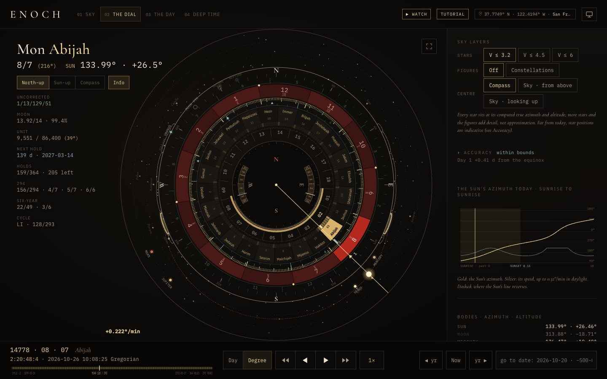
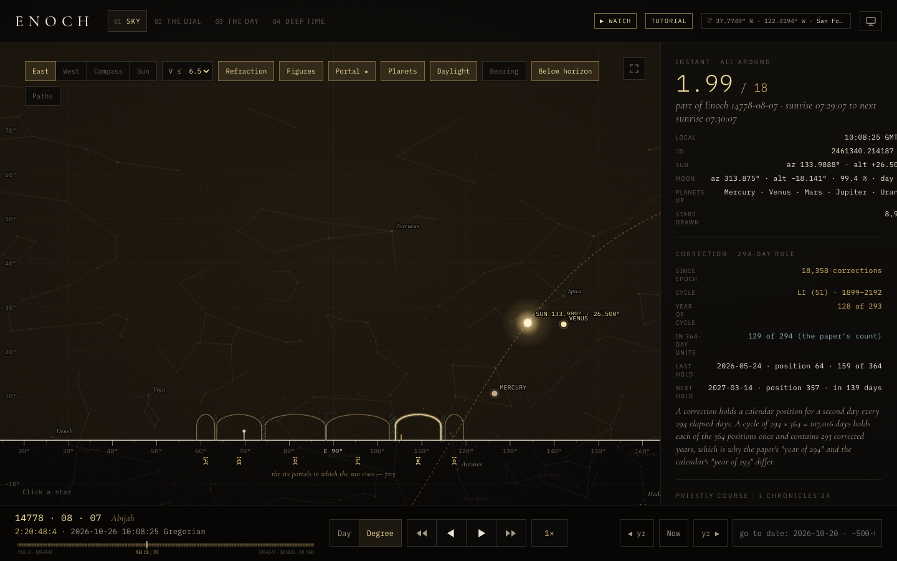
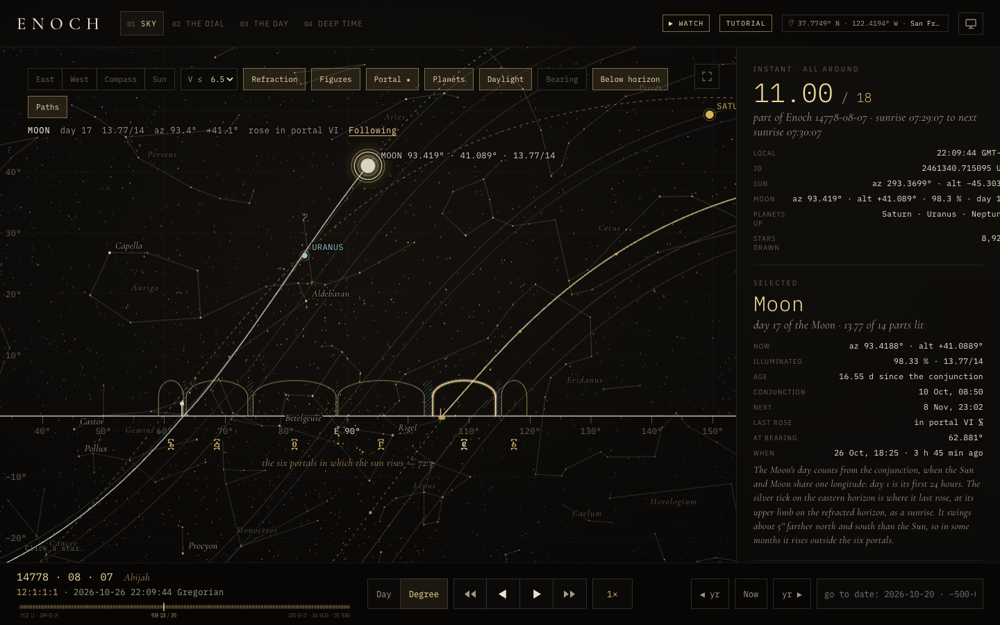
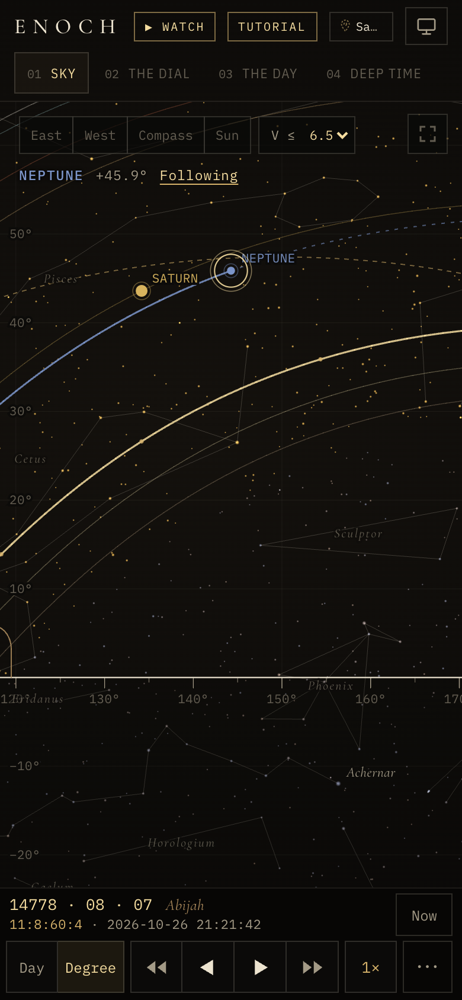
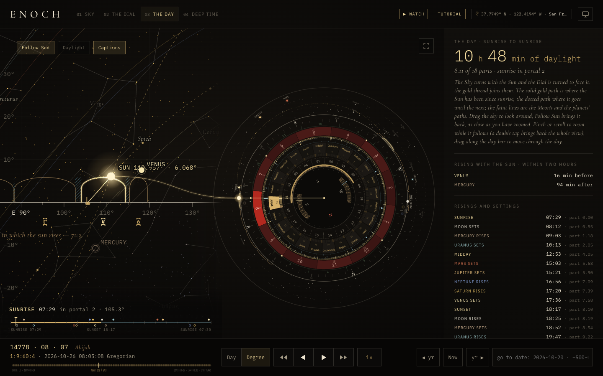
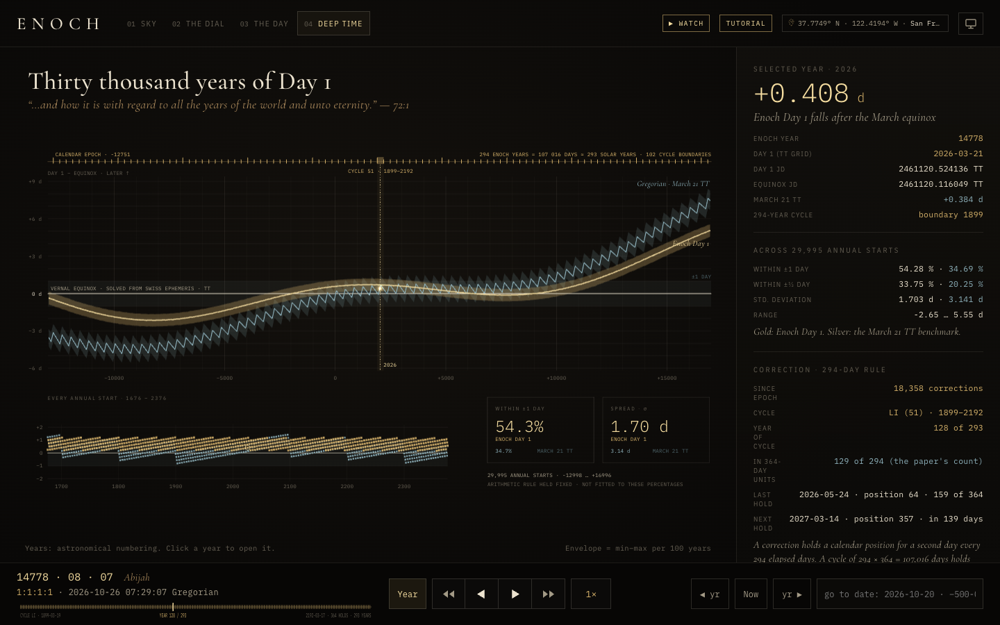
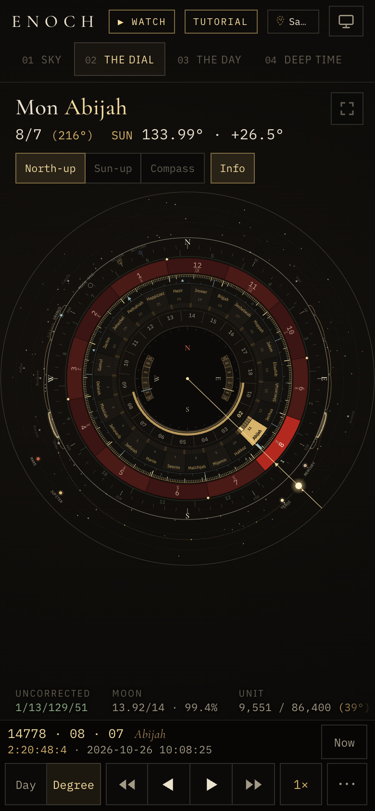

# Enoch Clock

**Live: <https://enochclock.com>**

An Enoch-driven clock, calendar and compass: the 364-day calendar of the Astronomical Book (1 Enoch 72–82) with its
294-day correction, calculated against the Swiss Ephemeris for any site and any Enoch year beginning between 12999 BCE and
16995 CE, and drawn as an interactive instrument.

It is a static site. Every calculation runs in your browser; nothing is sent to a server, not even your location.

[](https://enochclock.com)

## The instrument

Five views share one time cursor:

- **Sky.** The real sky over the six eastern portals (1 Enoch 72) at any of the 18 parts of the selected day: stars,
  constellation figures, Sun, Moon and planets. Turn to the east or west, or follow the device's compass.
  Tap the Sun, the Moon, a planet or any star and a line of reading appears under the options (where it is, and which
  portal it rises in); its **Follow** turns the view with it as the day or the years play. The Moon's reading also gives
  its day, counted from the conjunction, its light in fourteenths, and the portal it last rose in (a silver tick on the
  horizon marks where). **Paths** draws the day's course of the Sun, the Moon and each planet (solid behind it, dotted
  ahead), and of the body you follow.
- **The Dial.** Every layer of the calendar on one face, each ring turned onto the Sun's line, with the planets, Moon and
  bright stars. Frame it north-up, Sun-up or by compass.
- **The Day.** The Sky and the Dial together, sunrise to sunrise: the sky turns with the Sun and the Dial is turned to face
  it, joined by a gold thread through the Sun (sky over dial on a phone, side by side on a wide screen). Captions name each
  rising and setting as the day reaches it, and the day bar under it moves through the day.
- **Atlas.** The same instant seen from outside the Earth: the globe lit by the Sun of the moment, the site under a
  crosshair, the stars and planets behind, the tropics and the polar limit of the era (beyond it some day of the year has
  no sunrise, and the calculator refuses the year). Over the site, the camera turns with the Earth; from the stars, the
  Earth turns under a fixed sky. Drag the globe to move the site under the crosshair: while it moves, what a year there
  would show (its band, the span of the portals, the longest and shortest day); let go and the year is calculated there,
  the instant kept. The site chip opens Atlas. Coastlines: Natural Earth 1:50m. Dates and saved moments here are in
  progress ([`docs/atlas.md`](docs/atlas.md)).
- **Deep Time.** About 30,000 annual Day 1s against the independently solved March equinox, with the 294-year cycle
  boundaries. Click a year to open it.

| Sky | Following the Moon | On a phone |
|---|---|---|
|  |  |  |

| The Day | Deep Time | On a phone |
|---|---|---|
|  |  |  |

**Playback** is one bar on every view: step or play by the Day or by the Degree (1° is 1/360 of sunrise to sunrise), at
0.5× to 16×, forwards or in reverse. Playing past the end of an Enoch year carries on into the next one. **Now** follows the
present.

| Key | Action |
|---|---|
| Space | play / pause |
| ← → | step a day (Shift: a degree; in Deep Time, a year) |
| D · S | switch Day / Degree · change speed |
| N · F | follow now · fold away the top bar |
| 1 2 3 4 | Sky · The Dial · The Day · Deep Time |
| + − 0 | zoom Sky, The Day or Deep Time in, out, home |

Following a body, the view opens out as it climbs high or sinks deep so the horizon and the body are both in view. Zoom in
first and it follows that close; a pinch or the wheel zooms while it follows, and a double tap (or 0) brings back the whole
view. A drag, East, West or Compass takes the sky back. Selecting something else does not stop it: the body followed wears
a double ring, and with nothing selected the reading shows it, so **Following** is always there to tap. The Sun button
follows the Sun in one tap.

Each year carries an **Accuracy** section. It stays closed while Day 1 is within 1.5 days of the March equinox and the
uncertainty in Earth's rotation (ΔT) is under an hour; beyond that it opens and gives the reasons.

**Offline.** A device downloads only the era it is showing (two Swiss Ephemeris files, about 1.8 MB for 1800–2400) and
keeps it. The Offline section at the foot of the inspector installs the whole app (about 120 MB, with all 102 ephemeris
files) so that it opens and works with no connection.

**Observer.** Choose a preset, enter coordinates, or tap *Use my location*. The browser asks only when you tap.

## Run it

You need Node 22 or later.

```sh
npm ci
npm run dev          # http://127.0.0.1:4176
```

The first run downloads the Swiss Ephemeris files (about 98 MB) into `ephe/`, checking each against its SHA-256. They are
fetched from a pinned commit of [aloistr/swisseph](https://github.com/aloistr/swisseph) and are not stored in this repository.

Other commands:

| Command | What it does |
|---|---|
| `npm run build` | type-checks, then builds the site into `dist/` |
| `npm run preview` | serves `dist/` on http://127.0.0.1:4176 |
| `npm test` | runs the unit tests |
| `npm run fetch-ephe` | downloads the ephemeris files without building |
| `npm run video` | records a day as an mp4 (see [Day videos](#day-videos)) |

## Deploy

With Docker:

```sh
docker compose up -d --build     # http://127.0.0.1:4176
```

The image runs the tests, builds the site and serves it with nginx. Copy `.env.example` to `.env` to change the address it
binds to (`ENOCH_BIND`) or the repository the app's **Source** link points to (`VITE_SOURCE_URL`).

**Publishing enochclock.com** (beta and production): build with `npm run build:site`, not `npm run build`. It sets the two
things the hosted site needs and a plain build leaves off: `VITE_SOURCE_URL`, which shows the **Source** link to this
repository in the licence line under the inspector (the AGPL's offer of source to the people using the site), and
`VITE_FEEDBACK=1`, which shows the **Feedback** link (the site serves `POST /api/feedback`). A plain build has neither, so a
copy built that way publishes no link to its source. Then `deploy/push.sh beta` (or `prod`) uploads `dist/`; it refuses a
build that lacks either link.

`dist/` is the whole site. Any static host can serve it if it sends `.wasm` as `application/wasm` and sets the headers in
`nginx/`, which include a strict Content-Security-Policy. The compass, device location and the offline install need a
secure page: HTTPS, or `localhost`.

## The film

The **Watch** button and the **Primer** page play a short film, "The courses of the luminaries". Its videos are not in the
repository; [`film/`](film/README.md) holds the Remotion project that renders them.

## Day videos

`npm run video` records The Day, sunrise to sunrise, as a 1080 × 1920 mp4 for social media: a hidden page,
`studio.html`, draws each frame at its exact instant in headless Chrome (Playwright) and ffmpeg encodes them. It needs
ffmpeg and Chrome.

```sh
npm run video -- --date 2026-10-28 --site jerusalem
npm run video -- --date 2026-12-21 --lat 21.31 --lon -157.86 --tz Pacific/Honolulu --name Honolulu --seconds 30
npm run video -- --url https://enochclock.com --site london          # today, recorded from the live site
```

Presets for `--site`: `san-francisco`, `jerusalem`, `sydney`, `london`. Other options: `--seconds` (sunrise to sunrise,
default 40), `--fps`, `--intro` and `--hold` (seconds held at sunrise and on the closing summary), `--audio <file>`,
`--crf`, `--jobs`, `--out` (default `out/day-<date>-<site>.mp4`). Open `studio.html?date=…&site=…` in a browser to preview
and scrub a day.

## Layout

| Path | Contents |
|---|---|
| `src/` | the app (TypeScript, Three.js, Vite) |
| `src/calculator/` | the browser calculator: a worker that runs the Swiss Ephemeris (WebAssembly) and `engine/`, the calendar, sunrise and cycle arithmetic |
| `src/dial/`, `src/sky/`, `src/compass/`, `src/pwa/` | the Dial, the sky, the compass and magnetic declination, and offline install |
| `src/day/`, `src/studio/` | The Day (the Sky and the Dial together, its events), the follow that turns the Sky with a body (`follow.ts`), and the video frame |
| `public/` | fonts, icons, the star catalogue (`sky/`), Deep Time's data (`deep/`) and the Tutorial, Primer (Enoch) and Evidence (Phoenix) pages |
| `scripts/` | the ephemeris download, the build's staging steps and the day-video recorder |
| `tests/` | unit tests and their fixtures |
| `sw/`, `nginx/`, `nginx.conf` | the service worker and the web server configuration |
| `film/` | the film's source |

## Licence

Enoch Clock is free software under the GNU Affero General Public License, version 3 or (at your option) any later version.
See [LICENSE](LICENSE). If you host a modified copy, the AGPL requires you to offer your users its source: set
`VITE_SOURCE_URL` to where your copy's source is, and the app shows the link (`npm run build:site` does this for
enochclock.com).

Third-party software and data, with their licences, are listed in [THIRD-PARTY-NOTICES.md](THIRD-PARTY-NOTICES.md). The
Swiss Ephemeris is © Astrodienst AG; the star catalogue is HYG 4.1; the constellation figures are Stellarium's; the text of
1 Enoch 72–82 is R. H. Charles's 1912 translation.
